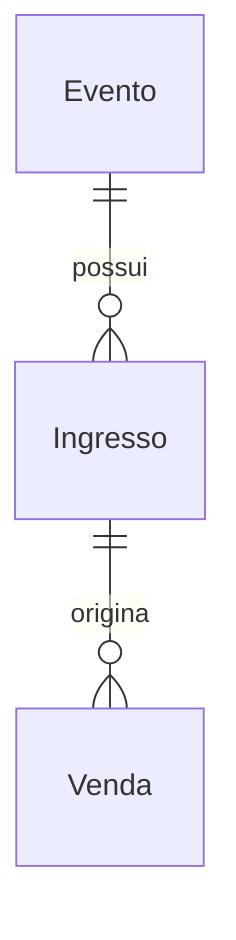

# Modelo de dados — Meia-Entrada

**Base**: [spec.md](spec.md), [research.md](research.md). Aplicação C# com EF Core 10 e SQLite; schema mantido por migrations.

## Relacionamentos



Uma venda alcança o evento pelo ingresso. Após qualquer venda, inclusive cancelada, o evento e o tipo do ingresso tornam-se imutáveis. Não duplicar EventoId em Venda: isso evita duas referências divergentes. Venda mantém as cópias históricas necessárias. Não há entidade de usuário, comprador ou pagamento.

## Evento

| Propriedade C# | Persistência SQLite | Validação |
|---|---|---|
| Id: long | INTEGER, PK gerada | Identificação estável |
| Nome: string | TEXT NOT NULL | Obrigatório, remover espaços das extremidades, rejeitar vazio |
| Descricao: string | TEXT NOT NULL | Obrigatória, texto simples |
| Local: string | TEXT NOT NULL | Obrigatório, texto simples |
| Data: DateOnly | TEXT, data ISO | Data válida, inclusive passada |
| Horario: TimeOnly | TEXT, hora ISO | Horário local válido; formulário com precisão de minuto |

Nomes podem repetir. Data e horário representam America/Sao_Paulo, sem conversão da data local em instante UTC. Consultas ordenam Data, Horario e Id crescentes. Edição mantém Id e não altera dados históricos das vendas.

## Ingresso

| Propriedade C# | Persistência SQLite | Validação |
|---|---|---|
| Id: long | INTEGER, PK gerada | Identificação estável |
| EventoId: long | INTEGER, FK Evento | Obrigatória, DeleteBehavior.Restrict |
| Tipo: enum TipoIngresso | TEXT por conversão explícita | `inteira` ou `meia_entrada` |
| PrecoCentavos: long | INTEGER | Não negativo; zero permitido |
| QuantidadeDisponivel: long | INTEGER | Inteiro não negativo; saldo atual |
| Versao: long | INTEGER, concurrency token EF | Inicia em 1; gerida pela aplicação |

Índice único `(EventoId, Tipo)`; índice da FK. CHECKs para tipo válido, preço/saldo não negativos e versão positiva. Para campos inteiros, garantir também `typeof(coluna) = 'integer'`, pois afinidade INTEGER sozinha não rejeita todo valor fracionário no SQLite. Textos obrigatórios têm NOT NULL e verificação de não vazio; whitespace completo é validado pelo serviço.

Preço inteira e meia-entrada são independentes. Não há capacidade global do evento. Versao é marcada com `IsConcurrencyToken()`, não `rowversion`/geração automática. Incrementa em toda edição de ingresso, venda concluída e cancelamento efetivo, incluindo mudança de preço. Cancelamento repetido não incrementa.

## Venda

| Propriedade C# | Persistência SQLite | Validação |
|---|---|---|
| Id: long | INTEGER, PK gerada | Identificação estável |
| IngressoId: long | INTEGER, FK Ingresso | Obrigatória, imutável, DeleteBehavior.Restrict |
| EventoNome: string | TEXT NOT NULL | Cópia do nome ao registrar |
| IngressoTipo: enum TipoIngresso | TEXT | Cópia de `inteira` ou `meia_entrada` |
| Quantidade: long | INTEGER | Estritamente positiva |
| PrecoUnitarioCentavos: long | INTEGER | Cópia do preço confirmado, >= 0 |
| ValorTotalCentavos: long | INTEGER | Produto exato de preço unitário e quantidade |
| RegistradaEmUtc: DateTime | TEXT no formato do provider | Instante UTC do servidor |
| Situacao: enum SituacaoVenda | TEXT | `registrada` ou `cancelada` |
| CanceladaEmUtc: DateTime? | TEXT anulável | Preenchida uma única vez ao cancelar |

Configurar conversão dos enums para os valores textuais do contrato, sem depender de ordinal. Instantes são sempre UTC; normalizar DateTime.Kind na leitura para não interpretar UTC como hora local. Exibir usando TimeZoneInfo para America/Sao_Paulo. Não persistir DateTimeOffset para ordenação nesse provider.

CHECKs: quantidade > 0, valores >= 0 e inteiros, tipo/situação válidos, total igual ao produto e coerência situação/instante: registrada exige CanceladaEmUtc nulo; cancelada exige valor não nulo. Antes de multiplicar, validar que preço <= long.MaxValue / quantidade; o cálculo e a constraint devem excluir produtos fora da faixa inteira, sem aceitar conversão implícita para REAL. Índice `(RegistradaEmUtc DESC, Id DESC)` e índice da FK.

## Precisão e limites de representação

Entradas monetárias usam decimal para validação e conversão exata em centavos. Rejeitar negativos, mais de duas casas, valores especiais e overflow; nunca arredondar silenciosamente ou converter para float/double. Quantidades, versões e centavos usam inteiros assinados de 64 bits; validação de limite ocorre antes da escrita. Multiplicação do total, soma de restituição e incremento da versão usam `checked`. Não impor um teto comercial adicional de ingressos.

Valores não representáveis produzem erro compreensível e nenhuma mutação. Para o cálculo de total exibido, usar o mesmo serviço/regra do registro. Na apresentação, converter centavos para decimal dividindo por 100m e formatar como BRL pt-BR.

## Estado e histórico

```text
registro válido → registrada → cancelada
                              cancelada → cancelada (sem efeito)
```

Não editar, excluir ou reativar vendas. Somente Situacao e CanceladaEmUtc mudam no cancelamento. O histórico usa EventoNome, IngressoTipo, PrecoUnitarioCentavos e ValorTotalCentavos da venda, nunca substituídos pelos valores atuais. Cancelamento soma a quantidade original ao saldo vigente, mesmo depois de ajuste manual.

## Transação de escrita única

Toda escrita do domínio passa pelos serviços de aplicação. Controllers não chamam SaveChanges; ViewModels não recebem entidades para gravação direta. DbContext/configurações/migrations isolam o mapeamento e consultas parametrizadas. Não criar repositório genérico ou caminhos administrativos que ignorem os serviços.

Protocolo comum:

1. Validar a sintaxe da entrada fora da transação, sem confiar em saldo, vínculo ou preço previamente lidos.
2. Criar contexto exclusivo da operação, abrir a conexão configurada e iniciar `BeginTransaction(deferred: false)` no Microsoft.Data.Sqlite. Vincular ao EF com `Database.UseTransaction` na mesma conexão. Nenhuma entidade carregada antes da transação deve orientar uma escrita.
3. Ler o estado atual, revalidar todas as regras dependentes do banco e preparar alterações. Não são necessários locks por linha: o arquivo tem um único escritor.
4. Salvar todas as alterações pela mesma transação e fazer commit. Vários SaveChanges, quando necessários, continuam dentro dessa unidade.
5. Em falha, desfazer a transação inteira e descartar o contexto; o rollback de apenas um savepoint não encerra a unidade de negócio. Renderizar a resposta somente após encerrar a transação.

| Operação | Revalidação dentro da transação | Alterações indivisíveis |
|---|---|---|
| Criar/editar evento | Campos válidos, existência na edição | Cadastro/edição |
| Excluir evento | Existência; nenhum ingresso vinculado | Excluir ou rejeitar vínculo |
| Criar ingresso | Evento existente, par evento/tipo único | Criar com Versao 1 |
| Editar ingresso | Existência, Versao recebida igual à atual; se evento/tipo mudar, nenhuma venda; destino existente e par único | Campos e Versao +1 |
| Excluir ingresso | Existência; nenhuma venda, inclusive cancelada | Excluir ou rejeitar vínculo |
| Registrar venda | Conferência válida, evento e ingresso existentes, vínculo/tipo/preço atuais conferidos, quantidade positiva e saldo suficiente | Criar venda histórica, reduzir saldo, Versao +1 |
| Cancelar venda | Venda e ingresso existentes; reler situação | Se registrada: somar saldo, Versao +1, situação e instante; se cancelada: nenhuma escrita |

Essa serialização também fecha disputas entre venda e exclusão, troca de evento do ingresso, edição do nome e alteração de preço. Se exclusão vencer, a venda encontra registro inexistente; se venda vencer, a exclusão encontra vínculo e é bloqueada. Se movimentação vencer uma edição aberta, Versao diverge e a edição é rejeitada, mesmo que o saldo tenha voltado ao número original.

## Espera, configuração e migrations

WAL para consultas concorrentes; `Foreign Keys=True` por conexão, cache padrão privado, `Default Timeout=30` e timeout EF de 30 segundos. Configurar `synchronous=FULL` em cada conexão e conferir WAL antes de atender requisições. Não usar read-uncommitted. O arquivo local e seus auxiliares não ficam em pasta pública ou compartilhamento de rede.

BUSY/LOCKED usa a espera limitada do provider. Após timeout com início não realizado ou rollback confirmado, responder 503 sem alterações; não repetir toda a operação automaticamente. Commit de resultado incerto não autoriza repetir venda: orientar consulta do histórico. Cancelamento reenviado continua protegido pela situação atual.

Aplicar migrations com a aplicação parada. Não misturar EnsureCreated com migrations; a criação inicial deve incluir FKs, CHECKs e índices no modelo EF. Alterações que reconstruam tabelas devem ser verificadas em banco com dados. Não gerar scripts idempotentes não suportados pelo provider.

## Evidências exigidas na implementação

Arquivo temporário real e conexões/contextos independentes: 20 vendas, 20 cancelamentos, venda e cancelamento simultâneos, edição obsoleta, preço alterado, exclusões/mudanças de vínculo concorrentes, falhas entre escritas, timeout, limites numéricos e migração preservando dados. Ler o resultado final com contexto novo. O protocolo completo e os resultados esperados constam em [quickstart.md](quickstart.md).
